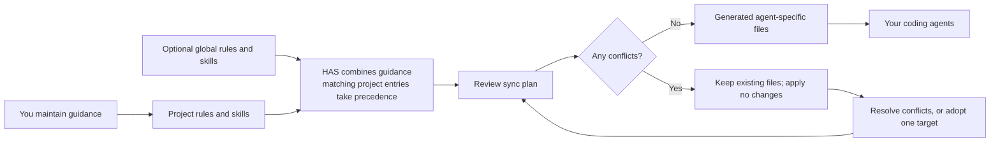

# Human-Agent Space

Human-Agent Space (`has`) keeps your project guidance in one human-owned place
and syncs it to the coding agents you use. Instead of maintaining separate
copies of instructions for each agent, write rules and skills once under
`.has/`, review changes safely, and keep the agent-specific files in sync.

[Website](https://fabr1ce.github.io/human-agent-space/) · [MIT License](LICENSE)

HAS helps when you switch between agents, work across several projects, or want
to preserve shared team guidance. It does not replace your normal editor, agent,
or workflow; you can keep working as usual and adopt HAS incrementally.

## How it fits together



## Install HAS from source

Requires Git and Node.js 22 or newer. The npm package is planned as
`human-agent-space`, but it is not published yet. The short npm name `has`
belongs to an unrelated package, so `npm install has` will not install
Human-Agent Space. Once the package is published, install it with
`npm install --global human-agent-space`. Until then, install from source:

```sh
mkdir -p "$HOME/src"
git clone https://github.com/Fabr1ce/human-agent-space.git "$HOME/src/human-agent-space"
cd "$HOME/src/human-agent-space"
npm ci
npm run build
```

Keep the checkout wherever convenient. To use its built CLI, set `HAS` to the
built entry point, then change to the **root of the project you want HAS to
configure**:

```sh
HAS="$HOME/src/human-agent-space/dist/bin/has.js"
cd /path/to/your/project
node "$HAS" init --workspace "$PWD"
node "$HAS" status --workspace "$PWD"
```

`init` creates `<project>/.has/` in the selected project; it does not initialize
the HAS source checkout. Add `--global` to `init` to create personal guidance
under `~/.has/` instead. Continue to invoke the source CLI as `node "$HAS"`
until a supported package distribution is available. The commands below use
`$HAS`; set it again if you open a new terminal.

Do not rely on `npx` or `npm exec` for HAS until the npm release is announced.

## Add guidance and sync it

After initialization, add Markdown files under `.has/rules/` and
`.has/skills/<skill-name>/SKILL.md`. Rules describe instructions that apply to
the whole project or selected files. Skills document reusable workflows and
may include supporting files. HAS validates and lists this content; it never
executes skill scripts.

```sh
HAS="$HOME/src/human-agent-space/dist/bin/has.js"
node "$HAS" rules list --workspace "$PWD"
node "$HAS" skills list --workspace "$PWD"
node "$HAS" sync --dry-run --workspace "$PWD"
node "$HAS" sync --workspace "$PWD"
```

Review the dry-run plan, then sync to generate project files for the supported
coding agents. Use `--agent kiro` to target Kiro alone.
`node "$HAS" sync --check --workspace "$PWD"` checks whether generated files
have drifted.
If any target conflicts with a hand-written or edited file, HAS preserves it
and applies **none** of that sync plan. Resolve conflicts, then rerun sync.
Before adopting a file, copy any edits you want to keep into the canonical
`.has/rules/` or `.has/skills/` source: `node "$HAS" adopt <path>` replaces
only that target, saves a local backup, and does not merge its edits back into
HAS. Add `--workspace "$PWD"` to the command when running it outside the
project root.

Project knowledge overrides global knowledge with the same rule ID or skill
name. Temporary runtime data is kept under `.has/.local/` and gitignored.
Verify agent trust settings in each agent; HAS cannot inspect them.

See [`docs/ADAPTERS.md`](docs/ADAPTERS.md) for supported formats and limitations.

## Contributing and running tests

From the HAS source checkout, install dependencies and run the build, tests,
and coverage gate:

```sh
npm ci
npm run build
npm test
npm run test:coverage
```

The coverage command enforces at least 85% line coverage.

## Community and security

See [CONTRIBUTING.md](CONTRIBUTING.md) to submit changes,
[SUPPORT.md](SUPPORT.md) for help, and [CODE_OF_CONDUCT.md](CODE_OF_CONDUCT.md)
for community expectations. Report vulnerabilities privately as described in
[SECURITY.md](SECURITY.md).
