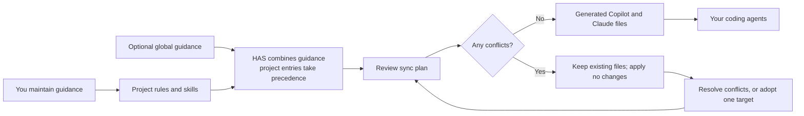

# Human-Agent Space

Human-Agent Space (`has`) keeps your project guidance in one human-owned place
and syncs it to the coding agents you use. Instead of maintaining separate
copies of instructions for each agent, write rules and skills once under
`.has/`, review changes safely, and keep the agent-specific files in sync.

HAS helps when you switch between agents, work across several projects, or want
to preserve shared team guidance. It does not replace your normal editor, agent,
or workflow; you can keep working as usual and adopt HAS incrementally.

## How it fits together



## Get started

Requires Node.js 22 or newer.

```sh
npm install
npm run build
npm test
```

For a source checkout, make the `has` command available by running `npm link`
from the HAS directory after building. If you prefer not to link it, invoke
`node /path/to/human-agent-space/dist/bin/has.js` from the project directory.

Initialize HAS **from the root of the project you want to configure**. This
creates `<project>/.has/`; it does not initialize whichever directory happens
to contain the installed HAS package.

```sh
cd /path/to/your/project
has init
has status
```

To initialize personal guidance shared across projects, run `has init
--global`; this creates `~/.has/`.

## Add guidance and sync it

After initialization, add Markdown files under `.has/rules/` and
`.has/skills/<skill-name>/SKILL.md`. Rules describe instructions that apply to
the whole project or selected files. Skills document reusable workflows and
may include supporting files. HAS validates and lists this content; it never
executes skill scripts.

```sh
has rules list
has skills list
has sync --dry-run
has sync
```

Review the dry-run plan, then sync to generate project files for GitHub Copilot
and Claude Code. `has sync --check` checks whether generated files have drifted.
If any target conflicts with a hand-written or edited file, HAS preserves it
and applies **none** of that sync plan. Resolve conflicts, then rerun sync.
Before adopting a file, copy any edits you want to keep into the canonical
`.has/rules/` or `.has/skills/` source: `has adopt <path>` replaces only that
target, saves a local backup, and does not merge its edits back into HAS.

Project knowledge overrides global knowledge with the same rule ID or skill
name. Temporary runtime data is kept under `.has/.local/` and gitignored.
Verify agent trust settings in each agent; HAS cannot inspect them.

See [`docs/ADAPTERS.md`](docs/ADAPTERS.md) for supported formats and limitations.
